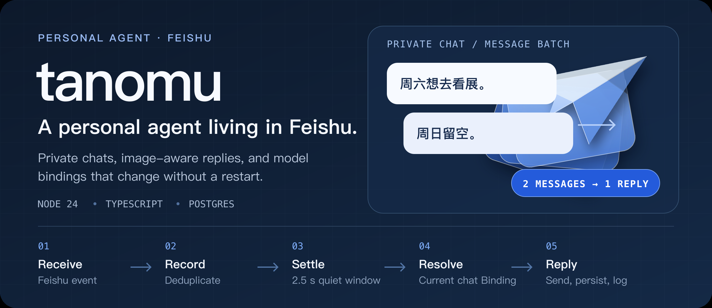
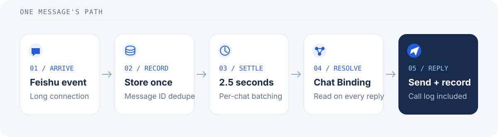

<p align="center">
  
</p>

## A personal agent, living where you chat

tanomu is a self-hosted agent for **Feishu private conversations**. It stores each conversation in Postgres, gathers rapid messages into one model call, accepts images with vision-capable models, and resolves the active model Provider for every reply.

- **Private by design.** Messages and replies belong to their Feishu conversation; there is no cross-conversation memory.
- **Bursts become one reply.** A 2.5-second quiet window collects rapid messages. Feishu redeliveries are deduplicated by message ID.
- **Bring your own model.** Use OpenAI-compatible, Anthropic, or Google providers through the Vercel AI SDK. A changed chat Binding applies to the next reply—no restart required.
- **Observable without logging image bytes.** Record model requests, responses, token usage, latency, and failures. Image attachments are logged as media type and size, not raw content.

## From message to reply

<p align="center">
  
</p>

The domain loop stays independent of Feishu and the database. Adapters connect the long-connection listener, Postgres, model Providers, and the admin console at the application boundary.

## Run it locally

You need Node 24+, Docker, a Feishu app, and a model Provider. The package manager is pnpm 11.20.0, available through Corepack.

```sh
corepack enable
pnpm install
cp .env.example .env
# Fill in .env with your Feishu app and model Provider settings.
docker compose up -d db
pnpm dev
```

The server applies migrations on startup. To open the admin console, run `pnpm dev:admin` in another terminal and visit [localhost:3000](http://localhost:3000). For Feishu sign-in, allow `http://localhost:3000/auth/feishu/callback` in the app's Security settings and publish a new app version.

Send a private message in Feishu to try the full loop. **Only one listener receives each Feishu event:** if production uses the same app, stop its listener before testing locally. See the [local-listener warning](docs/deployment.md#4-local-development-shares-the-production-feishu-app).

## Current scope

- Private Feishu conversations are implemented. Group conversations, long-term Memory, feeds, and digests are design directions, not shipped features.
- Replies use the **current message batch**. Stored conversation history is not yet replayed to the model.
- The initial Provider and chat Binding are imported from environment variables only when no chat Binding exists. Later `CHAT_*` changes do not replace a stored Binding.
- Model request and response content is retained in the call log. Protect the database and its backups accordingly.

## Project map

- [`packages/core`](packages/core) — Conversation domain logic and message batching; no Feishu or database imports.
- [`apps/server`](apps/server) — Node process, Feishu listener, Postgres adapters, Providers, and HTTP.
- [`apps/admin`](apps/admin) — React admin console, built by Vite and served by the server.
- [`deploy`](deploy) — Production Compose configuration and database backups.

## Develop

```sh
pnpm test          # Unit tests
pnpm test:db       # Unit + Postgres-backed tests; requires the local compose DB
pnpm test:factory  # Software-factory controller and workflow tests
pnpm lint
pnpm typecheck
```

Read the [domain glossary](GLOSSARY.md), [architecture decisions](docs/adr), [implementation guide](docs/agents/implementing.md), and [deployment runbook](docs/deployment.md) before contributing.
